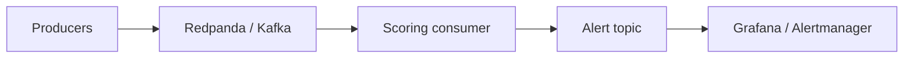

# Realtime Anomaly Ops

An event-scoring API for operational telemetry. The core detector keeps a rolling baseline per metric and returns an explainable z-score, severity and alert decision. In deployment, events enter through Redpanda/Kafka and alerts can be exported to Alertmanager.



## Quick start

```bash
python -m venv .venv && source .venv/bin/activate
pip install -r requirements.txt
uvicorn src.api:app --port 8001
curl -X POST localhost:8001/v1/events -H 'content-type: application/json' -d '{"metric":"checkout_latency_ms","value":980,"baseline":[120,130,110,125,135,128]}'
```

The response includes the feature values used in the decision, which is useful for on-call triage.

Use `docker compose up --build` for the local Redpanda + API stack. API docs and health are at `/docs` and `/health`.
