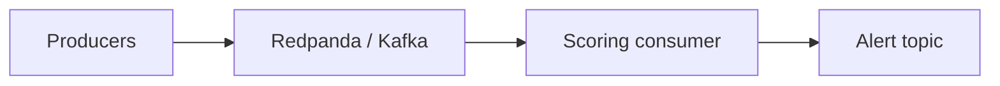

# Realtime Anomaly Ops

A streaming detector for operational telemetry. A Kafka consumer maintains a rolling baseline per metric and publishes anomalous events with their z-score and severity.



## Quick start

```bash
python -m venv .venv && source .venv/bin/activate
pip install -r requirements.txt
uvicorn src.api:app --port 8001
curl -X POST localhost:8001/v1/events -H 'content-type: application/json' -d '{"metric":"checkout_latency_ms","value":980,"baseline":[120,130,110,125,135,128]}'
```

The response includes the feature values used in the decision, which is useful for on-call triage.

## Stream demo

Run the same bounded smoke test as CI with `docker compose up --build -d` followed by `docker compose exec -T scorer python -m src.smoke`. It prints the matching alert and exits with an error if it cannot verify delivery.

At startup the worker ensures both demo topics exist. Each topic uses one partition and one replica for the local single-broker stack.

To inspect the topics manually:

```bash
docker compose up --build -d
for value in 120 130 110 125 135 128 980; do
  printf '{"metric":"checkout_latency_ms","value":%s}\n' "$value"
done | docker compose exec -T redpanda rpk topic produce telemetry -k checkout_latency_ms
docker compose exec redpanda rpk topic consume alerts -n 1
```

The first five samples warm up the window. The final spike should produce a critical alert. Keep the metric name as the Kafka key so its samples reach the same partition. Flagged values stay out of the rolling window. The worker commits the source offset after broker acknowledgement of an alert. A replay can produce duplicates, so downstream consumers can deduplicate on the included `source` identifier. Windows live in memory and warm up again after a restart. Use a bounded set of metric names in this demo.
